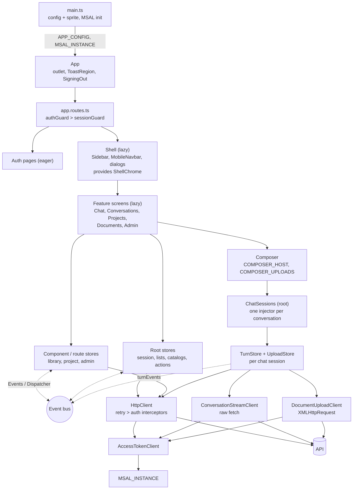

# Codebase Map

Where everything in the Angular client lives and what it is wired to: folders, stores, injection
seams, events, API calls and routes. Use it to find the file for a screen, store, token, event or
endpoint, and to see what depends on what.

Paths in tables are relative to `enterprise-gpt-ui/src/app/` unless a column says otherwise; the Key
files table uses repo-root-relative paths. The layer rules, naming, bootstrap order and styling chain
are in [../architecture/frontend.md](../architecture/frontend.md) and are not repeated here.

## Runtime wiring

`main.ts` loads `config.json` and the icon sprite, initializes MSAL, then bootstraps `App` with
`APP_CONFIG` and `MSAL_INSTANCE` as plain values. `App` hosts the router outlet and the toast region.
`authGuard` then `sessionGuard` gate everything but the auth pages; the lazy `Shell` supplies the
sidebar, navbar and the shared dialogs, and each feature screen renders inside it. Screens read
stores and never touch `HttpClient` directly. Stores talk to the API through `HttpClient` (retry,
then auth interceptors), with two exceptions that bypass it: the chat stream (raw `fetch`) and file
upload (`XMLHttpRequest`). Stores that must not import each other communicate through the NgRx event
bus.

## `core/<topic>/`

App-wide singletons, the root stores more than one feature injects, and the stateful widgets several
features render. `core/` imports no feature.

| Topic | Owns | Main files | Consumed by |
| --- | --- | --- | --- |
| `a11y/` | Focus moves | `focus-on-render.ts` (`focusOnRender`, one shot after first render), `recover-focus.ts` (`recoverFocusOn(source)`, an effect that returns focus to `#main-content` when a change to `source` removes the focused control) | Auth pages, `SigningOut`; `ToastRegion`, `AdminModels`, `AdminMcps` |
| `api/` | Wire DTOs, URL building, transport policy, request-state store features | `api-url.ts` (`ApiUrl.build/segment/owns`), `retry-interceptor.ts` (`retryInterceptor`, `skipRetry`), `assistant-ui-contract.ts` (vendored stream contract and `foldAssistantEvents`), `*.model.ts` (`conversation`, `project`, `document`, `user`, `chat-model`, `mcp`, `provider`, `usage-report`, `conversation-export`, `paginated-response`, `permission-ids`), `with-request-status.ts`, `with-offset-pagination.ts`, `with-pending-ids.ts`, `with-client-query.ts` | Every store and client |
| `auth/` | MSAL handshake, tokens, guards, interceptor | `auth.ts` (`Auth`: handshake, `signIn`, `signOut`, cross-tab sign-out), `access-token-client.ts` (`AccessTokenClient`), `auth-interceptor.ts`, `auth-guard.ts`, `session-guard.ts`, `admin-guard.ts` (`adminCanMatch`), `msal-instance-token.ts` (`MSAL_INSTANCE`, `buildMsalConfig`) | `app.config.ts`, `app.routes.ts`, stream and upload clients, `App` |
| `catalog/` | What the signed-in user may pick: models, MCP servers, their credentials | `model-catalog-store.ts`, `mcp-catalog-store.ts`, `mcp-credential-store.ts`, `provider-meta.ts`, `mcp-server.ts` (`needsUserApiKey`, `isMcpServerRetired`) | Composer menus, `TurnSettingsStore`, `SessionBootstrap`, shell `McpCredentialDialog`, admin |
| `composer/` | The prompt box and everything it needs | `composer.ts` (+ `.html`/`.scss`), `model-menu.ts`, `tools-menu.ts`, `composer-host-token.ts` (`COMPOSER_HOST`, `provideComposerHost`), `turn-settings-store.ts`, `pending-prompt-store.ts`, `pending-attachments-store.ts`, `dictation-store.ts`, `speech-recognition-token.ts` | `ChatSessionView`, `ProjectDetail`; stores by `TurnStore`, `ProjectComposerHostStore`, `ConversationStore` |
| `config/` | Runtime config and the pre-bootstrap shell | `app-config.ts` (`AppConfig`, `AppConfigError`), `app-config-token.ts` (`APP_CONFIG`), `load-app-config.ts`, `fatal-shell.ts`, `startup-shell-handoff.ts` | `main.ts`, `ApiUrl`, `Auth`, stream client, telemetry |
| `conversations/` | The conversation list and everything done to a conversation row | `conversation-list-store.ts` (reference list store), `conversation-actions-store.ts`, `conversation-activity-store.ts`, `conversation-export-store.ts`, `conversation-update.ts` (`toUpdateBody`), `conversation-download-menu.ts` | Sidebar, `Chat`, `Conversations`, project screens, composer |
| `dnd/` | Stops a stray file drop navigating away | `prevent-drop-navigation.ts` | `app.config.ts` |
| `documents/` | Signed-link downloads | `document-download-store.ts`, `document-target-path.ts` (`documentTargetPath`) | `UploadStore`, document rows, project files, generated files |
| `errors/` | `AppError` normalization, retry policy, the shared error panel | `app-error.ts`, `to-app-error.ts`, `to-app-error-from-response.ts`, `problem-types.ts`, `retry-policy.ts` (`RETRY_POLICY`), `server-messages.ts` (`serverMessagesFor`), `error-panel.ts` | Everything; see [errors.md](errors.md) |
| `events/` | The six `eventGroup`s | `session-events.ts` (also `injectSignedOut`, `injectSignedOutAbort`), `conversation-events.ts`, `project-events.ts`, `turn-events.ts`, `mcp-events.ts`, `admin-events.ts` | See [Event bus](#event-bus) |
| `icons/` | Inline SVG sprite loader | `load-icon-sprite.ts` | `main.ts` |
| `layout/` | Shell-to-screen slot for the mobile navbar | `shell-chrome.ts` (`ShellChrome`) | `Shell` provides; `Chat`, `AdminLayout` publish; `MobileNavbar` reads |
| `navigation/` | Route constants, matcher, document-level navigation | `route-paths.ts` (`CHAT_ROUTE`, `ADMIN_ROUTE`, ...), `chat-matcher.ts` (`chatMatcher`, `CONVERSATION_ID_PARAM`), `hard-navigation.ts` (`assign` resolves against `document.baseURI`), `unload-prompt.ts` (`UnloadPrompt`), `page-changes.ts` (`injectPageChanges`), `navigation-failure.ts` (`notifyNavigationFailure`) | Guards, `Auth`, `ChatSessions`, route files, `Shell` |
| `notifications/` | Toasts | `toast-store.ts`, `toast-region.ts`, `toast-item.ts`, `toast.model.ts` | `App` mounts the region; most action stores raise toasts |
| `preferences/` | The only `localStorage` call site | `local-preferences.ts` (`PREFERENCE_KEYS`: `theme`, `sidebar`) | `Theme`, `UiStore` |
| `projects/` | Project lookup, mutations, per-project conversation list | `project-lookup-store.ts`, `project-actions-store.ts`, `project-conversations-store.ts`, `project-picker.ts`, `project-update.ts` (`toProjectBody`), `project-summary.ts`, `project-load.ts`, `duplicate-name.ts` | Sidebar, `Composer`, `Chat`, `Projects`, project detail, shell dialogs |
| `session/` | Identity, bootstrap, sign-out reset | `session-store.ts`, `session-bootstrap.ts` (`SessionBootstrap`), `with-reset-on-sign-out.ts`, `session-channel.ts` (cross-tab sign-out), `signing-out.ts` | Guards, `App`, every store |
| `telemetry/` | Lazy Application Insights | `browser-telemetry.ts` (`provideBrowserTelemetry`, `TELEMETRY_LOADER`) | `app.config.ts` |
| `theme/` | Light/dark/system preference | `theme.ts` (`Theme`), `theme-toggle.ts` | `app.config.ts` (eager), sidebar user footer, `MarkdownExtras` |
| `uploads/` | Upload state machine and transport | `upload-store.ts`, `document-upload-client.ts` (XHR), `upload-status-client.ts`, `upload-cancel-client.ts`, `supported-extensions-store.ts`, `composer-uploads-token.ts` (`COMPOSER_UPLOADS`), `upload-xhr-token.ts` (`UPLOAD_XHR`), `upload-rejection.ts`, `upload-schedule.ts` | `ChatSessions`, `ProjectDetail`, `Composer` |
| `users/` | Messages for refused self-actions | `self-action-messages.ts` | Admin users |

## `features/<feature>/`

Each feature is flat: route target, `*.routes.ts` and `-route.ts` URL contracts, components and its
own stores. Features never import each other.

| Feature | Serves | Entry component | Stores it provides or owns | Notable contents |
| --- | --- | --- | --- | --- |
| `auth/` | `auth`, `login-failed`, `session-error`, `signed-out`, `forbidden` | `AuthCallback`, `LoginFailed`, `SessionError`, `SignedOut`, `Forbidden` | none | `auth-page.ts` (shared page frame); eager, no shell |
| `shell/` | Layout route around every signed-in screen | `shell.ts` (`Shell`) | `ShellChrome` (provided); `UiStore` (root) | `mobile-navbar.ts`, `ui-store.ts`, `mcp-credential-dialog.ts`/`mcp-credential-form.ts`; `sidebar/` (`sidebar.ts`, `conversation-row.ts`, `sidebar-favorites.ts`, `sidebar-project-row.ts`, `sidebar-project-conversations.ts`, `user-footer.ts`); `conversation-actions/` (rename, delete dialogs); `project-actions/` (project form, delete dialogs). Hosts the dialogs the sidebar, library and chat all open |
| `chat/` | `/chat`, `/chat/{id}` | `chat.ts` (`Chat`) | `ConversationStore`, `provideChatMarkdown()` on `Chat`; `TurnStore` per session; `ChatSessions` (root) | `chat-session-view.ts` (transcript + composer, rendered into the session's injector), `chat-composer-host.ts` (`ChatComposerHost`), `chat-session-token.ts` (`CHAT_SESSION`), `conversation-stream-client.ts`, `stream-fetch-token.ts`, `transcript-pinning.ts`, `chat-empty-state.ts` |
| `chat/stream/` | no components | none | none | Framework-free wire handling: `sse-frame-codec.ts`, `raw-text-codec.ts`, `stream-codec.ts` (interface), `turn-timeline.ts` (`foldTimeline`), `replayed-turn.ts`, `reasoning-timing.ts`, `activity-label.ts`, `turn-announcement.ts` |
| `chat/transcript/` | none | `transcript.ts` | none | Per-entry rendering: `assistant-turn.ts`, `activity-card.ts`, `reasoning-region.ts`, `stopped-card.ts`, `turn-notice-card.ts`, `email-card.ts`, `email-open-menu.ts`, `generated-files.ts`, `message-copy.ts`, `message-feedback.ts`, `turn-usage.ts` |
| `chat/markdown/` | none | none | `LazyRendererLoader` (via `provideChatMarkdown`) | `markdown-providers.ts` (sanitizer, marked options), `markdown-extras.ts`, `lazy-renderer-loader.ts` (`DIAGRAM_MODULE`, `MATH_MODULE`), `streaming-split.ts`, `math-extension.ts`, `diagram-svg.ts`, `fences.ts`, `prism.ts`; see [answer-rendering.md](answer-rendering.md) |
| `chat/email/` | none | none | none | Pure drafting: `email-draft.ts`, `compose-url.ts`, `plain-text.ts` |
| `conversations/` | `/conversations` | `conversations.ts` | `ConversationLibraryStore` (component) | `conversations-route.ts` (`?name`, `?favorites`, `?sort`), `delete-conversations-dialog.ts` (bulk) |
| `documents/` | `/documents` | `documents.ts` | `DocumentLibraryStore` (component) | `documents-route.ts` (`?name`, `?view`, `?source`), `document-row.ts` |
| `projects/` | `/projects`, `/projects/{id}/{instructions,files,conversations}` | `projects.ts` (grid), `project-detail.ts` | `ProjectListStore` (grid component); `ProjectStore`, `ProjectDocumentsStore`, `ProjectConversationsStore` (detail route); `UploadStore` x2 and `ProjectComposerHostStore` (detail component) | `projects-layout.ts`, `projects.routes.ts`, `project-detail.routes.ts`, `projects-route.ts` (`?name`, `?sort`), `instructions-panel.ts`, `project-files.ts`, `project-conversations.ts`, `unsaved-instructions-guard.ts` |
| `admin/` | `/admin/**` | `admin-layout.ts` | none (each tab provides its own) | `admin.routes.ts`, `admin-tabs.ts`, `admin-columns.ts` |
| `admin/users/` | `/admin/users` | `admin-users.ts` | `AdminUsersStore` (component); `UserActionsStore` (root) | `admin-users-route.ts` (`?name`, `?page`, `?size`, `?permission`), `user-form-dialog.ts`, `user-edit-panel.ts`, `permission-checklist.ts`, `deactivate-user-dialog.ts` |
| `admin/chat-models/` | `/admin/models` | `admin-models.ts` | `AdminModelsStore` (component); `ModelActionsStore` (root) | `model-form-dialog.ts`, `model-form.ts`, `deactivate-model-dialog.ts`, `model-status.ts`, `model-format.ts` |
| `admin/mcps/` | `/admin/mcps` | `admin-mcps.ts` | `AdminMcpsStore` (component); `McpServerActionsStore` (root) | `mcp-server-form-dialog.ts`, `mcp-server-form.ts`, `deactivate-mcp-server-dialog.ts` |
| `admin/reports/` | `/admin/reports` | `admin-reports.ts` | `AdminReportsStore` (component, fresh per entry) | `admin-reports-route.ts` (`?range`, `?group`), `kpi-tile.ts`, `usage-area-chart.ts`, `usage-bar-list.ts`, `outcome-donut.ts`, `range-segmented.ts`, `usage-format.ts` |
| `ui-kit/` | `/ui-kit` (dev only) | `ui-kit.ts` | none | `ui-kit.routes.ts`; the gallery that renders every `shared/` primitive |

## `shared/<theme>/`

Presentational components, directives and pure functions. They import no `core/` or `features/` code
except `*.model.ts`.

| Theme | Kind of primitive | Examples |
| --- | --- | --- |
| `avatar/` | Initials avatar | `avatar-initials.ts`, `initials.ts` |
| `badges/` | Status and kind chips | `activity-indicator.ts`, `status-dot.ts`, `source-badge.ts`, `kind-badge.ts`, `permission-badge.ts` |
| `brand/` | Logo and ridgeline artwork | `brand-logo.ts`, `ridgeline.ts` |
| `cards/` | Entity card | `project-card.ts` |
| `data-table/` | Table, mobile card rows, selection | `data-table.ts`, `table-column.model.ts`, `card-row.ts`, `bulk-action-bar.ts`, `row-selection.ts` |
| `dialog/` | Native `<dialog>` modal and offcanvas | `modal.ts`, `offcanvas.ts`, `focus-return.ts`, `tabbable.ts` |
| `downloads/` | Anchor-click download | `anchor-download.ts` |
| `empty-state/` | Empty and unavailable panels | `empty-state.ts`, `unavailable-panel.ts` |
| `file-drop/` | Drop target and overlay | `file-drop-target.ts`, `drop-overlay.ts` |
| `files/` | Attachment chip and file glyph | `attachment-chip.ts`, `attachment.model.ts`, `file-glyph.ts` |
| `formatting/` | Pure formatters | `bytes.ts`, `relative-time.ts` |
| `forms/` | Form controls and the field-error contract | `switch.ts`, `field-errors.ts` (`FieldErrors`, `FieldErrorState`), `invalid-field.ts` (`InvalidField`), `not-blank.ts` (`notBlank`) |
| `icons/` | Sprite icons | `icon.ts`, `icon-names.ts`, `brand-icon.ts`, `mcp-icon.ts` |
| `layout/` | Breakpoints and media queries | `breakpoints.ts`, `media-query.ts` (`injectMediaQuery`) |
| `loading/` | Skeleton placeholder | `skeleton.ts` |
| `menu/` | Menu and items | `menu.ts`, `menu-item.ts`, `menu-separator.ts`, `menu-trigger-content.ts` |
| `navigation/` | Sub-navigation, search history | `pill-subnav.ts`, `search-history.ts` |
| `overlay/` | Anchored panel, dismiss, tooltip | `anchored-panel.ts`, `dismiss.ts`, `tooltip.ts` |
| `pagination/` | Paginator | `paginator.ts`, `page-window.ts` |
| `search/` | Search box | `search-input.ts` |

## `src/testing/`

Test-only. Specs import through `@testing/*`; `test-providers.ts` and `setup-dom.ts` are wired in
`angular.json` and load for every unit test.

| Helper | Fakes or builds |
| --- | --- |
| `setup-dom.ts`, `test-providers.ts` | Per-file DOM setup; the providers every test gets (exhaustive change-detection check) |
| `app-config.ts` | `testAppConfig`, `provideTestAppConfig`, `TEST_API_BASE_URL` |
| `msal.ts` | `fakeMsalInstance`, `signedInMsal`, `signedOutMsal`, `provideFakeMsal` |
| `navigation.ts`, `unload-prompt.ts` | `provideFakeNavigation` (`HardNavigation`); `armUnloadPrompt` |
| `session.ts`, `users.ts` | `userFixture`, `administratorFixture`, grants; `directoryUserFixture`, `userPage` |
| `conversations.ts`, `projects.ts`, `documents.ts`, `catalog.ts`, `reports.ts` | DTO and page fixtures per area |
| `conversation-activity.ts` | `connectActivity`, a stand-in for the `ChatSessions` port |
| `stream-frames.ts` | Wire-accurate stream events and byte helpers (`fullTurnEvents`, `frame`, `splitBytes`) |
| `upload-xhr.ts` | `FakeUploadXhr`, `FakeUploadXhrQueue`, `provideFakeUploadXhr` |
| `speech.ts` | `FakeRecognition` for `SPEECH_RECOGNITION` |
| `problem-fixtures.ts` | One canned problem body per application type |
| `media-query.ts`, `intersection-observer.ts`, `resize-observer.ts`, `dialog-polyfill.ts`, `drag.ts` | jsdom gaps: `matchMedia`, observers, `<dialog>`, `DragEvent` |
| `markdown-host.ts` | Drives source through the real markdown pipeline |
| `overlays.ts`, `async.ts` | Menu and dialog queries; draining promise chains |
| `a11y.ts`, `a11y-routes.ts`, `a11y-coverage.spec.ts` | axe harness and the `AXE_ROUTES` list; `npm run test:a11y` runs the audits |

## Stores

`root` is `providedIn: 'root'`. Almost every store composes `withResetOnSignOut`; the exceptions are
`UiStore` (device-local) and `DictationStore` (component-scoped, dies with its composer). Endpoint
paths are relative to `api/`.

### Root

| Store | File | Holds | Endpoints | Injected by |
| --- | --- | --- | --- | --- |
| `SessionStore` | `core/session/session-store.ts` | `user` and permissions; `isAdministrator`, `canUploadFiles` | `POST users/me` | `SessionBootstrap`, `adminCanMatch`, sidebar, user footer, `Composer`, `SessionError`, admin users, project files |
| `UiStore` | `features/shell/ui-store.ts` | `sidebarCollapsed`, persisted in `localStorage` | none | `Shell` |
| `ToastStore` | `core/notifications/toast-store.ts` | Live toasts, timers for the timed ones, the persistent cap, keyed replacement | none | `ToastRegion` and most action stores |
| `ModelCatalogStore` | `core/catalog/model-catalog-store.ts` | Models the user may pick (`withEntities`, memoized load) | `GET models` | `SessionBootstrap`, `TurnSettingsStore`, `Composer`, `ModelMenu`, `Conversations` |
| `McpCatalogStore` | `core/catalog/mcp-catalog-store.ts` | MCP servers the user may use, credential status | `GET mcps` | `SessionBootstrap`, `TurnSettingsStore`, `ToolsMenu` |
| `McpCredentialStore` | `core/catalog/mcp-credential-store.ts` | Per-server save/remove in flight | `PUT mcps/{id}/credential`, `DELETE mcps/{id}/credential` | `ToolsMenu`, `McpCredentialDialog` |
| `ConversationListStore` | `core/conversations/conversation-list-store.ts` | Sidebar conversations (`withEntities`, `withOffsetPagination`, `withPendingIds`); the reference list store | `GET conversations/search` | `SessionBootstrap`, sidebar, `Chat`, `ConversationStore`, `TurnStore`, actions and activity stores |
| `ConversationActionsStore` | `core/conversations/conversation-actions-store.ts` | Rename and delete dialog targets; optimistic row edits | `PUT conversations` (rename, move), `DELETE conversations/{id}`, `DELETE conversations/bulk`, `PUT conversations/{id}/favorite` | Sidebar rows, `Chat`, `Conversations`, `ProjectConversations`, `ProjectPicker`, shell dialogs |
| `ConversationActivityStore` | `core/conversations/conversation-activity-store.ts` | `unseen` map, `atCapacity`, summaries; reads the `connect()` port | `GET conversations/{id}` (name after a first turn) | Sidebar, rows, `MobileNavbar`, `Composer`, `Conversations`, `ChatSessions`, `TurnStore` |
| `ConversationExportStore` | `core/conversations/conversation-export-store.ts` | Export in flight | `GET conversations/{id}/export?format=` (blob) | `ConversationDownloadMenu` |
| `ProjectLookupStore` | `core/projects/project-lookup-store.ts` | Drained project set up to 500 (`withEntities`), `favorites`, `nameOf` | `GET projects?sort=favorite` | `SessionBootstrap`, sidebar, `Composer`, `ProjectPicker`, `Conversations` |
| `ProjectActionsStore` | `core/projects/project-actions-store.ts` | Form and delete targets | `POST projects`, `GET projects/{id}`, `PUT projects/{id}`, `DELETE projects/{id}`, `PUT projects/{id}/favorite` | `Projects`, `ProjectDetail`, `InstructionsPanel`, `ProjectPicker`, sidebar, project dialogs |
| `DocumentDownloadStore` | `core/documents/document-download-store.ts` | Per-document download pending ids | `GET documents/{conversations\|projects}/{id}/{documentId}` | `UploadStore`, `DocumentRow`, `ProjectFiles`, `GeneratedFiles` |
| `SupportedExtensionsStore` | `core/uploads/supported-extensions-store.ts` | Accepted file extensions | `GET documents/file-extensions` | `Composer`, `UploadStore`, `ProjectFiles` |
| `TurnSettingsStore` | `core/composer/turn-settings-store.ts` | Selected model and MCP servers for the next turn | none | `Composer`, menus, `TurnStore`, `ConversationStore` |
| `PendingPromptStore` | `core/composer/pending-prompt-store.ts` | One prompt handed across navigation; single-shot, id-matched | none | `TurnStore`, `ProjectComposerHostStore` |
| `PendingAttachmentsStore` | `core/composer/pending-attachments-store.ts` | `File` handles handed across navigation | none | `TurnStore`, `ChatSessions`, `ProjectComposerHostStore` |
| `UserActionsStore` | `features/admin/users/user-actions-store.ts` | User dialog targets and busy flags | `GET permissions`, `POST users`, `PUT users/{id}`, `DELETE users/{id}` | Admin users and its dialogs |
| `ModelActionsStore` | `features/admin/chat-models/model-actions-store.ts` | Model dialog targets (`withPendingIds`) | `POST models`, `PUT models/{id}` (edit, set default), `DELETE models/{id}` | Admin models and its dialogs |
| `McpServerActionsStore` | `features/admin/mcps/mcp-server-actions-store.ts` | MCP dialog targets (`withPendingIds`) | `POST mcps`, `PUT mcps/{id}`, `DELETE mcps/{id}` | Admin MCPs and its dialogs |

### Route- and component-provided

| Store | File | Provided at | Holds | Endpoints | Injected by |
| --- | --- | --- | --- | --- | --- |
| `ConversationStore` | `features/chat/conversation-store.ts` | `Chat` | The open conversation's detail | `GET conversations/{id}` | `Chat`, `ChatSessionView`, `ChatComposerHost` |
| `ConversationLibraryStore` | `features/conversations/conversation-library-store.ts` | `Conversations` | Searchable, paginated library | `GET conversations/search` | `Conversations` |
| `DocumentLibraryStore` | `features/documents/document-library-store.ts` | `Documents` | Document rows, grouped or flat | `GET documents` | `Documents` |
| `ProjectListStore` | `features/projects/project-list-store.ts` | `Projects` | Project grid | `GET projects` | `Projects` |
| `ProjectStore` | `features/projects/project-store.ts` | `project-detail.routes.ts` | One project's detail, `deleted` flag; cleared when bound to a different id | `GET projects/{id}` | `ProjectDetail`, tabs, `ProjectComposerHostStore` |
| `ProjectDocumentsStore` | `features/projects/project-documents-store.ts` | `project-detail.routes.ts` | A project's files; cleared when bound to a different id | `GET projects/{id}/documents`, `DELETE projects/{id}/documents/{documentId}` | `ProjectDetail`, `ProjectFiles` |
| `ProjectConversationsStore` | `core/projects/project-conversations-store.ts` | `project-detail.routes.ts`; also each `SidebarProjectConversations` | A project's conversations; cleared when bound to a different id | `GET conversations/search?projectId=` | `ProjectDetail`, `ProjectConversations`, sidebar |
| `ProjectComposerHostStore` | `features/projects/project-composer-host-store.ts` | `ProjectDetail` | Draft and create-in-flight; implements `ComposerHost` | `POST conversations` | `Composer`, through `COMPOSER_HOST` only |
| `UploadStore` (project) | `core/uploads/upload-store.ts` | `ProjectDetail` | Files-tab transfers, bound to the project | via upload clients | `ProjectDetail`, `ProjectFiles` |
| `DictationStore` | `core/composer/dictation-store.ts` | `Composer` | Speech-recognition state | none | `Composer` |
| `AdminUsersStore` | `features/admin/users/admin-users-store.ts` | `AdminUsers` | Directory page (`withEntities`) | `GET users` | `AdminUsers` |
| `AdminModelsStore` | `features/admin/chat-models/admin-models-store.ts` | `AdminModels` | All models (`withClientQuery`) | `GET models/all` | `AdminModels` |
| `AdminMcpsStore` | `features/admin/mcps/admin-mcps-store.ts` | `AdminMcps` | All MCP servers (`withClientQuery`) | `GET mcps/all` | `AdminMcps` |
| `AdminReportsStore` | `features/admin/reports/admin-reports-store.ts` | `AdminReports` | Usage report for `range` and `group` | `GET reports/usage?from=&groupBy=` | `AdminReports` |

### Per chat session

`ChatSessions` builds one `EnvironmentInjector` per conversation holding `UploadStore`, `TurnStore` and
`CHAT_SESSION`, and destroys it when the session is idle with nothing unsent. See
[../conversations/turn-lifecycle.md](../conversations/turn-lifecycle.md#one-session-per-conversation).

| Store | File | Holds | Endpoints | Injected by |
| --- | --- | --- | --- | --- |
| `TurnStore` | `features/chat/turn-store.ts` | Transcript entries, draft, in-flight turn, Stop | `GET conversations/{id}/messages`, `POST conversations`, `POST conversations/{id}/stream` (via `ConversationStreamClient`), `POST conversations/{id}/messages/{messageId}/feedback` | `Transcript`, `TranscriptPinning`, `ChatComposerHost`, `ChatSessionView`, `ChatSessions` |
| `UploadStore` (session) | `core/uploads/upload-store.ts` | Composer chips for that conversation; uploads deferred until send | via upload clients | `TurnStore`, `Composer` through `COMPOSER_UPLOADS` |

### Services that hold state

| Service | File | Scope | Holds |
| --- | --- | --- | --- |
| `ChatSessions` | `features/chat/chat-sessions.ts` | root | The session registry, `active`, `running`, `runningCount`; `activate`/`deactivate`/`stop` |
| `ShellChrome` | `core/layout/shell-chrome.ts` | `Shell` | Navbar title and actions template; inject with `{ optional: true }` |
| `Auth` | `core/auth/auth.ts` | root | `isSigningOut`; MSAL handshake memo |
| `Theme` | `core/theme/theme.ts` | root | Preference and resolved theme |
| `UnloadPrompt` | `core/navigation/unload-prompt.ts` | root | Registered "work would be lost" signals |
| `LazyRendererLoader` | `features/chat/markdown/lazy-renderer-loader.ts` | `Chat` | Memoized diagram and math renderers |

Three clients are plain root services: `DocumentUploadClient`, `UploadStatusClient` and
`UploadCancelClient`, all in `core/uploads/`.

## Injection seams

Tokens and ports that let one layer reach another without importing it. A token with a root factory
is a production default that specs replace.

| Seam | Defined in | Provided by | Injected by | Why |
| --- | --- | --- | --- | --- |
| `APP_CONFIG` | `core/config/app-config-token.ts` | `main.ts` (`useValue`) | `ApiUrl`, `Auth`, `AccessTokenClient`, `ConversationStreamClient`, `ConversationActivityStore`, `LazyRendererLoader`, telemetry | Runtime config is fetched before the injector exists |
| `MSAL_INSTANCE` | `core/auth/msal-instance-token.ts` | `main.ts` (`useValue`) | `Auth`, `AccessTokenClient` | MSAL must be initialized before bootstrap |
| `COMPOSER_HOST` | `core/composer/composer-host-token.ts` | `provideChatComposerHost()` in `ChatSessionView`; `provideComposerHost(ProjectComposerHostStore)` in `ProjectDetail` | `Composer` | One composer, two executors of a prompt |
| `COMPOSER_UPLOADS` | `core/uploads/composer-uploads-token.ts` | `provideSharedComposerUploads()` (`useExisting` the session's `UploadStore`) in `ChatSessionView`; `provideComposerUploads()` (`useClass`, unbound) in `ProjectDetail` | `Composer`, `ProjectComposerHostStore` | The chips drawn must be the ones the host gates its send on |
| `CHAT_SESSION` | `features/chat/chat-session-token.ts` | `ChatSessions.create` | `TurnStore` | A turn asks whether its session is on screen before navigating |
| Activity port | `ConversationActivityStore.connect()` in `core/conversations/` | `ChatSessions` constructor calls it | `ConversationActivityStore` reads it | `core/` may not import `features/chat/`; exposes `running`, `runningCount`, `viewing`, `stop(id)` |
| `ShellChrome` | `core/layout/shell-chrome.ts` | `Shell` | `Chat`, `AdminLayout` (publish); `MobileNavbar` (read) | Screens fill the mobile navbar without importing the shell |
| `UnloadPrompt.register()` | `core/navigation/unload-prompt.ts` | `ChatSessions` registers `runningCount() > 0` | `Auth` and `HardNavigation` honour it | A reload ends every in-flight turn |
| `STREAM_FETCH` | `features/chat/stream-fetch-token.ts` | root default (`globalThis.fetch`) | `ConversationStreamClient` | Specs swap the transport |
| `UPLOAD_XHR` | `core/uploads/upload-xhr-token.ts` | root default (`new XMLHttpRequest`) | `DocumentUploadClient` | A factory, because a 401 replay needs a second request |
| `SPEECH_RECOGNITION` | `core/composer/speech-recognition-token.ts` | root default (`null` where unsupported) | `DictationStore` | `null` hides the mic control |
| `RETRY_POLICY` | `core/errors/retry-policy.ts` | root default | `retryInterceptor` | Specs pin backoff |
| `TELEMETRY_LOADER` | `core/telemetry/browser-telemetry.ts` | root default (dynamic `import()`) | `provideBrowserTelemetry` | Keeps the SDK a lazy chunk |
| `DIAGRAM_MODULE`, `MATH_MODULE` | `features/chat/markdown/lazy-renderer-loader.ts` | root defaults (dynamic `import()`) | `LazyRendererLoader` | Mermaid and KaTeX stay lazy; jsdom cannot lay out Mermaid |
| `provideChatMarkdown()` | `features/chat/markdown/markdown-providers.ts` | `Chat` | `ngx-markdown`, `Transcript` | The markdown stack rides the lazy chat chunk |

## Event bus

The NgRx `Events`/`Dispatcher` carry server-confirmed facts between stores that cannot reach each
other. Rules are in [state.md](state.md#cross-store-events). `injectSignedOut()` is the observable
form of `sessionEvents.signedOut`.

| Event | Payload | Dispatched by | Observed by, and what they do |
| --- | --- | --- | --- |
| `sessionEvents.signedOut` | void | `Auth.signOut`, and `Auth` on a cross-tab sign-out (both `scope: 'global'`) | Every store through `withResetOnSignOut` (restore initial state) and `takeUntil(injectSignedOut())` (drop in-flight work); `Auth` (clear handshake memo and return-URL keys); `ToastStore` (clear timers and actions); `ChatSessions` (destroy inactive sessions); `McpCatalogStore` (drop memo); `ConversationStreamClient` via `injectSignedOutAbort` (abort the fetch) |
| `conversationEvents.updated` | `ConversationDto` | `ConversationActionsStore` (rename, favorite, move); `ConversationActivityStore` (first-turn name) | `ConversationStore` (patch open detail); `ConversationLibraryStore` (patch row, drop if unstarred under the filter); `ProjectConversationsStore` (patch, re-read when moved in, drop when moved out); `DocumentLibraryStore` (patch `conversationName`) |
| `conversationEvents.deleted` | conversation id | `ConversationActionsStore` (single and bulk) | `Chat` (navigate to `/chat` if open); `ChatSessions` (destroy the session); `ConversationActivityStore` (`markSeen`); `ConversationLibraryStore`, `ProjectConversationsStore` (drop row); `DocumentLibraryStore` (drop its documents) |
| `projectEvents.created` | `ProjectDto` | `ProjectActionsStore` | `ProjectLookupStore`, `ProjectListStore` (prepend, list only if it matches the active search) |
| `projectEvents.updated` | `ProjectDto` | `ProjectActionsStore` | `ProjectLookupStore`, `ProjectListStore` (patch row; the grid drops a card renamed out of its search); `ProjectStore` (adopt DTO) |
| `projectEvents.deleted` | project id | `ProjectActionsStore` | `ProjectLookupStore`, `ProjectListStore` (drop row); `ProjectStore` (set `deleted`, which `ProjectDetail` navigates on); `ConversationListStore.releaseProject` and `ConversationStore` (clear the stale `projectId`) |
| `projectEvents.favorited` | `{ id, isFavorite }` | `ProjectActionsStore` | `ProjectLookupStore`, `ProjectListStore`, `ProjectStore` (patch the flag only) |
| `turnEvents.completed` | `{ conversationId, wasFirstTurn }` | `TurnStore` on a folded `Finished` | `ConversationActivityStore` (mark `answer` if out of sight, raise "Answer ready", fetch the name after a first turn) |
| `turnEvents.interrupted` | `{ conversationId }` | `TurnStore` on a cut-off or failure, never Stop | `ConversationActivityStore` (mark `interrupted`, no toast) |
| `mcpEvents.credentialChanged` | `McpCredentialStatusDto` | `McpCredentialStore` | `McpCatalogStore` (patch the row's credential status) |
| `adminEvents.userCreated` | `UserDto` | `UserActionsStore` | `AdminUsersStore` (refresh) |
| `adminEvents.userUpdated` | `UserDto` | `UserActionsStore` | `AdminUsersStore` (patch row) |
| `adminEvents.userDeactivated` | user id | `UserActionsStore` | `AdminUsersStore` (remove row) |
| `adminEvents.modelCatalogChanged` | void | `ModelActionsStore` (create, update, set default, deactivate) | `ModelCatalogStore` (reload); `AdminModelsStore` (refresh) |
| `adminEvents.mcpCatalogChanged` | void | `McpServerActionsStore` (create, update, deactivate) | `McpCatalogStore` (reload); `AdminMcpsStore` (refresh) |

## API surface

Every call the client makes, from `ApiUrl.build(...)` and the two transports that bypass
`HttpClient`. Paths are relative to `{apiBaseUrl}/api/`. `HttpClient` calls carry the bearer token
through `authInterceptor`; `retryInterceptor` retries `GET` only.

| Method and path | Made by | Triggered from |
| --- | --- | --- |
| `POST users/me` | `SessionStore` | `sessionGuard` on first signed-in navigation |
| `GET models` | `ModelCatalogStore` | Session bootstrap; model reload after an admin change |
| `GET mcps` | `McpCatalogStore` | Session bootstrap; reload after an admin change |
| `PUT mcps/{id}/credential`, `DELETE mcps/{id}/credential` | `McpCredentialStore` | Tools menu, credential dialog |
| `GET conversations/search` (`skip`, `take`, `sort`, `dir`, `name`, `isFavorite`, `projectId`) | `ConversationListStore` (sidebar), `ConversationLibraryStore`, `ProjectConversationsStore` | Sidebar, `/conversations`, project Conversations tab and sidebar project rows |
| `GET conversations/{id}` | `ConversationStore`, `ConversationActivityStore` | Opening `/chat/{id}`; naming a conversation after its first turn |
| `GET conversations/{id}/messages` | `TurnStore` | Opening or reopening a conversation |
| `POST conversations` (`{ projectId }`) | `TurnStore`; `ProjectComposerHostStore` | First prompt on `/chat`; prompt typed on a project screen |
| `POST conversations/{id}/stream` (raw `fetch`, SSE) | `ConversationStreamClient` | Send or retry on `/chat` |
| `POST conversations/{id}/messages/{messageId}/feedback` | `TurnStore` | Thumbs on an answer |
| `PUT conversations` (full body, id inside) | `ConversationActionsStore` | Rename dialog; move to project |
| `DELETE conversations/{id}`, `DELETE conversations/bulk` (body `{ conversationIds }`) | `ConversationActionsStore` | Delete dialog; library bulk bar |
| `PUT conversations/{id}/favorite` | `ConversationActionsStore` | Star control |
| `GET conversations/{id}/export?format=` (blob) | `ConversationExportStore` | Download menu on `/chat` and in the composer |
| `GET projects` | `ProjectLookupStore` (`sort=favorite`, drained to 500), `ProjectListStore` | Session bootstrap; `/projects` |
| `GET projects/{id}` | `ProjectStore`, `ProjectActionsStore` (edit form) | Project detail; edit dialog |
| `POST projects`, `PUT projects/{id}`, `DELETE projects/{id}`, `PUT projects/{id}/favorite` | `ProjectActionsStore` | Project form, instructions panel, delete dialog, star control |
| `GET projects/{id}/documents`, `DELETE projects/{id}/documents/{documentId}` | `ProjectDocumentsStore` | Project Files tab |
| `GET documents` (`skip`, `take`, `name`, `type`) | `DocumentLibraryStore` | `/documents` |
| `GET documents/file-extensions` | `SupportedExtensionsStore` | Composer; project Files tab |
| `POST documents/{conversations\|projects}/{id}` (XHR, multipart) | `DocumentUploadClient` | Attaching a file; the session `TurnStore` posts deferred files at send |
| `GET documents/upload-status/{jobId}`, `DELETE documents/upload-status/{jobId}` | `UploadStatusClient`; `UploadCancelClient` | Polling after upload; cancelling a busy chip |
| `GET documents/{conversations\|projects}/{id}/{documentId}` | `DocumentDownloadStore` | Download on a document row, project file, generated file |
| `GET permissions` | `UserActionsStore` | Admin user form |
| `GET users`, `POST users`, `PUT users/{id}`, `DELETE users/{id}` | `AdminUsersStore`; `UserActionsStore` | `/admin/users` and its dialogs |
| `GET models/all`, `POST models`, `PUT models/{id}`, `DELETE models/{id}` | `AdminModelsStore`; `ModelActionsStore` | `/admin/models` and its dialogs |
| `GET mcps/all`, `POST mcps`, `PUT mcps/{id}`, `DELETE mcps/{id}` | `AdminMcpsStore`; `McpServerActionsStore` | `/admin/mcps` and its dialogs |
| `GET reports/usage` (`from`, `groupBy`) | `AdminReportsStore` | `/admin/reports` |

Outside `ApiUrl`: `load-app-config.ts` fetches `config.json`, `load-icon-sprite.ts` fetches the sprite,
MSAL talks to Entra, and the Application Insights SDK posts to its own endpoint. Wire details for the
stream are in [../conversations/streaming.md](../conversations/streaming.md); uploads in
[../documents/downloads.md](../documents/downloads.md) and
[../admin/projects.md](../admin/projects.md#the-client).

## Routes

`app.routes.ts` is the root table; `*.routes.ts` files under `features/` are lazy children. Guard
nesting and `canMatch` versus `canActivate` are explained in
[../architecture/frontend.md](../architecture/frontend.md#routing). `withComponentInputBinding()` binds
path params and query params to component inputs by name.

| URL | Component | Guards | Route-provided | Inputs bound |
| --- | --- | --- | --- | --- |
| `/` | redirect to `chat` | none | none | none |
| `/auth`, `/login-failed`, `/session-error`, `/signed-out` | `AuthCallback`, `LoginFailed`, `SessionError`, `SignedOut` (eager) | none | none | none |
| `/ui-kit` | `UiKit` via `ui-kit.routes.ts` | `canMatch: isDevMode()` | none | none |
| `/forbidden` | `Forbidden` (eager, outside the shell) | `authGuard` > `sessionGuard` | none | none |
| `/chat`, `/chat/{id}` | `Chat` (lazy), matched by `chatMatcher` | `authGuard` > `sessionGuard` | `ConversationStore`, markdown providers (on the component) | `conversationId` (undefined on `/chat`) |
| `/conversations` | `Conversations` | same | `ConversationLibraryStore` (component) | `name`, `favorites`, `sort` |
| `/documents` | `Documents` | same | `DocumentLibraryStore` (component) | `name`, `view` (`flat`), `source` (`generated`) |
| `/projects` | `Projects` inside `ProjectsLayout` | same | `ProjectListStore` (component) | `name`, `sort` |
| `/projects/{projectId}` | redirect to `instructions` | same | `ProjectStore`, `ProjectDocumentsStore`, `ProjectConversationsStore` on the route | `projectId` (required) on `ProjectDetail` |
| `/projects/{projectId}/instructions` | `InstructionsPanel` | `canDeactivate: unsavedInstructionsGuard` | shared with parent | none |
| `/projects/{projectId}/files` | `ProjectFiles` | none beyond parents | shared with parent | none |
| `/projects/{projectId}/conversations` | `ProjectConversations` | none beyond parents | shared with parent | none |
| `/admin` | `AdminLayout`, redirect to `users` | `canMatch: adminCanMatch` | none | none |
| `/admin/users` | `AdminUsers` | same | `AdminUsersStore` (component) | `name`, `page`, `size`, `permission` |
| `/admin/models` | `AdminModels` | same | `AdminModelsStore` (component) | none |
| `/admin/mcps` | `AdminMcps` | same | `AdminMcpsStore` (component) | none |
| `/admin/reports` | `AdminReports` | same | `AdminReportsStore` (component) | `range` (7, 30, 90), `group` (`model`, `provider`, `user`, `day`) |
| `/admin/**` | redirect to `users` | same | none | none |
| `**` | redirect to `chat` | none | none | none |

Query-param contracts (names, defaults, `to*` parsers) live in each feature's `-route.ts`:
`conversations-route.ts`, `documents-route.ts`, `projects-route.ts`, `admin/users/admin-users-route.ts`,
`admin/reports/admin-reports-route.ts`. Route constants shared with `core/` are in
`core/navigation/route-paths.ts`.

## Where to put new code

Step-by-step recipes are in [workflows.md](workflows.md).

| You are adding | Put it in | Copy |
| --- | --- | --- |
| A screen | `features/<feature>/`, with its route in the feature's `*.routes.ts` or `app.routes.ts` under `Shell` | `features/documents/` (screen, `-route.ts`, library store) |
| A store one feature uses | The feature folder, provided on the screen or route | `DocumentLibraryStore`; `ProjectStore` for route-shared |
| A store several features use, or a guard or core service injects | `core/<topic>/`, `providedIn: 'root'` | `ConversationListStore` (list), `ConversationActionsStore` (mutations) |
| A mutation that other stores must hear about | An `eventGroup` in `core/events/`, dispatched by the root actions store after the server confirms | `projectEvents` and `ProjectActionsStore` |
| A presentational component or directive | `shared/<theme>/`, no `core/` or `features/` imports | `shared/badges/status-dot.ts`; show it in `features/ui-kit/` |
| A component that injects a store | The `core/` topic or feature it serves | `core/errors/error-panel.ts`, `core/projects/project-picker.ts` |
| A pure function | Beside its only consumer; `shared/formatting/` if general | `core/projects/project-update.ts`, `shared/formatting/bytes.ts` |
| A wire DTO | `core/api/<name>.model.ts`, importing only other models | `core/api/project.model.ts` |
| A token for a browser API or lazy chunk | `<name>-token.ts` in the owning topic, with a root factory default and a fake in `src/testing/` | `core/uploads/upload-xhr-token.ts` and `testing/upload-xhr.ts` |
| A URL-driven filter | A `-route.ts` beside the screen with `to*` parsers and input transforms | `features/projects/projects-route.ts` |

## Key files

| Path | Role |
| --- | --- |
| `enterprise-gpt-ui/src/main.ts` | Pre-injector bootstrap; provides `APP_CONFIG` and `MSAL_INSTANCE` |
| `enterprise-gpt-ui/src/app/app.config.ts` | Providers: router, interceptors, eager `Theme` and `Auth`, telemetry |
| `enterprise-gpt-ui/src/app/app.routes.ts` | Root route table and guard nesting |
| `enterprise-gpt-ui/src/app/features/shell/shell.ts` | The layout route; provides `ShellChrome` |
| `enterprise-gpt-ui/src/app/features/chat/chat-sessions.ts` | Per-conversation sessions and the activity port |
| `enterprise-gpt-ui/src/app/features/chat/turn-store.ts` | The turn pipeline and the `turnEvents` publisher |
| `enterprise-gpt-ui/src/app/core/conversations/conversation-list-store.ts` | The reference list store |
| `enterprise-gpt-ui/src/app/core/composer/composer-host-token.ts` | `COMPOSER_HOST` and its provider helper |
| `enterprise-gpt-ui/src/app/core/uploads/composer-uploads-token.ts` | `COMPOSER_UPLOADS` and its two providers |
| `enterprise-gpt-ui/src/app/core/events/session-events.ts` | `signedOut`, `injectSignedOut`, `injectSignedOutAbort` |
| `enterprise-gpt-ui/src/app/core/api/api-url.ts` | The only place API URLs are built |
| `enterprise-gpt-ui/src/app/core/navigation/chat-matcher.ts` | One route config for `/chat` and `/chat/{id}` |
| `enterprise-gpt-ui/src/testing/test-providers.ts` | Providers installed into every unit test |
| `enterprise-gpt-ui/src/app/features/chat/chat-sessions.spec.ts` | Session lookup, retention and disposal |
| `enterprise-gpt-ui/src/app/core/events/session-events.spec.ts` | Sign-out abort signals |

## Related

- [../architecture/frontend.md](../architecture/frontend.md)
- [state.md](state.md)
- [errors.md](errors.md)
- [design-system.md](design-system.md)
- [layout-and-navigation.md](layout-and-navigation.md)
- [workflows.md](workflows.md)
- [../conversations/turn-lifecycle.md](../conversations/turn-lifecycle.md)
- [../conversations/streaming.md](../conversations/streaming.md)
