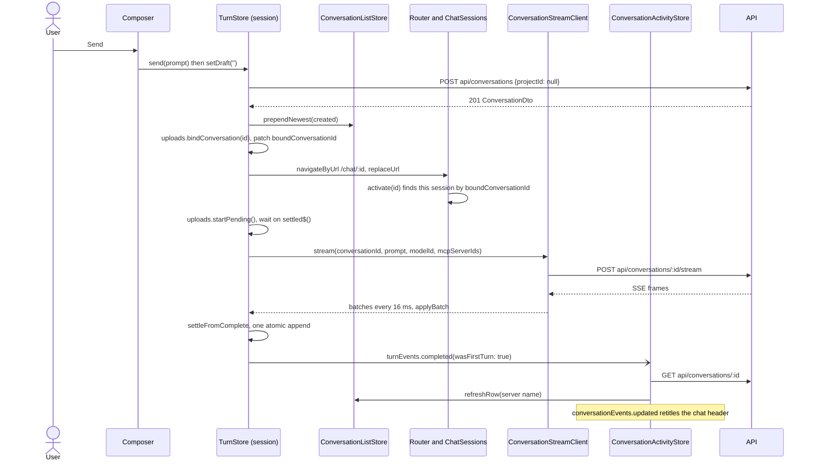
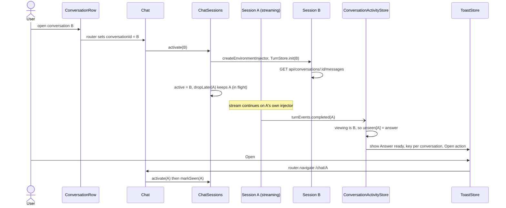
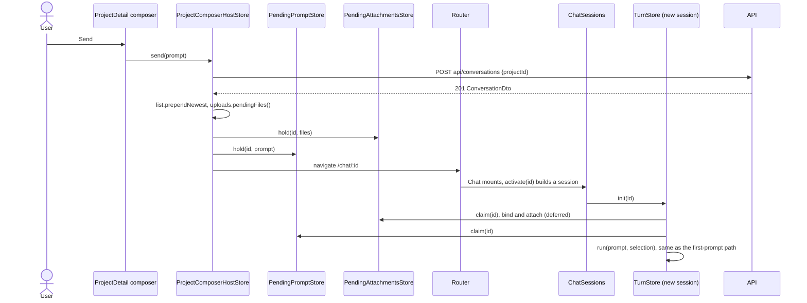

# Frontend Workflows

How the pieces of the Angular client work together at runtime: for each important user journey, the
hop-by-hop path through components, stores, tokens, events, clients and API endpoints, followed by
short recipes for the common "how do I add X" tasks.

The folder, store, token, event and endpoint inventory is in [codebase-map.md](codebase-map.md). The
rules behind the chat journeys are in [turn-lifecycle.md](../conversations/turn-lifecycle.md); this
doc traces the path and links there.

Paths are relative to `enterprise-gpt-ui/src/app/` unless they start with `src/` or `scripts/`. API
paths are relative to the API base URL (`ApiUrl.build`). In a hop, `Store.method` is a call, **event**
is a `@ngrx/signals/events` dispatch, and an unqualified `GET`/`POST` is an HTTP request.

## 1. App start and sign-in

Everything before the first routed render runs in a fixed order, because each step needs the one
before it: config, then MSAL, then the router, then a token, then the user. The startup card in
`index.html` stays up until the first navigation settles.

1. `src/main.ts` `start()` runs `Promise.all([loadAppConfig(), loadIconSprite()])`. `GET config.json`
   (a static file resolved against `document.baseURI`, not an API call). A missing or invalid file
   calls `showFatalShell` and **does not bootstrap**.
2. `createStandardPublicClientApplication(buildMsalConfig(...))` creates and initializes MSAL
   (`core/auth/msal-instance-token.ts`). A malformed authority fails here, not at sign-in.
3. `bootstrapApplication(App, ...)` with `APP_CONFIG` and `MSAL_INSTANCE` as real values
   (`app.config.ts`). App initializers instantiate `Theme` and `Auth`; `Auth`'s constructor subscribes
   this tab to `SessionChannel` and to `sessionEvents.signedOut`. `provideStartupShellHandoff()`
   arms the card removal; `withEnabledBlockingInitialNavigation()` starts the first navigation.
4. `app.routes.ts`. `/auth`, `/login-failed`, `/session-error` and `/signed-out` are eager and
   unguarded. Everything else enters the `authGuard` level.
5. `authGuard` awaits `Auth.ready()`, which memoizes `handleRedirectPromise({ navigateToLoginRequestUrl:
   false })` and selects the account.
   - Redirect error: returns the `/login-failed` `UrlTree`.
   - Account present: passes.
   - No account: `Auth.signIn(state.url)` stores the return URL in `sessionStorage`, calls
     `loginRedirect` inside `UnloadPrompt.leaving()`, and the guard returns `false`. The browser
     leaves for Entra with the startup card still showing.
6. Entra returns to `/auth`. `features/auth/auth-callback.ts` awaits `Auth.ready()`, then
   `navigateByUrl(consumeReturnUrl(), { replaceUrl: true })`. The stored URL is untrusted: anything
   but an in-app absolute path falls back to `/chat`. A handshake with neither account nor error is
   absorbed once (`noteInconclusiveHandshake`), then goes to `/login-failed`.
7. `sessionGuard`, nested one level inside `authGuard` so a token exists, awaits
   `SessionBootstrap.ensureSession()` (`core/session/session-bootstrap.ts`) which awaits
   `SessionStore.ensureLoaded()`: **`POST api/users/me`**, memoized. A failure returns the
   `/session-error` tree.
8. On success, `ensureSession()` starts four loads without awaiting them: `ModelCatalogStore`
   `GET api/models`, `McpCatalogStore` `GET api/mcps`, and the `_started` sentinels of
   `ConversationListStore` and `ProjectLookupStore`, whose `onInit` queries then fire (§2).
9. The lazy `Shell` and the matched child load. The first navigation to settle decides the startup
   card's fate, in `afterNextRender` so bootstrap still finds `<app-root>`:
   - `NavigationEnd` or `NavigationSkipped`: `hideStartupShell()`.
   - `NavigationError`: `showFatalShell` turns the card into the failure screen ("The application
     could not be loaded"), because there is no screen to hand over to.
   - `NavigationCancel`: the card stays, since a cancel means a redirect follows.

   A navigation that fails *after* that, typically a lazy chunk a new deployment replaced, reaches
   `notifyNavigationFailure` (`core/navigation/navigation-failure.ts`), registered with
   `withNavigationErrorHandler`. It raises an error toast keyed `navigation-failure` with a
   **Reload** action that calls `HardNavigation.reload()`, since only a reload fetches the new chunk.
10. `/admin` differs: `adminCanMatch` runs during URL recognition, **before** any `canActivate`, so it
    resolves `Auth.ready()` and `ensureSession()` itself, then returns `/forbidden` for a non-admin
    without fetching the admin chunk.

The other auth screens (`features/auth/`), all unguarded:

| Screen | Reached when | Exit |
| --- | --- | --- |
| `LoginFailed` | Handshake error, or a redirect that could not start | Retry calls `Auth.signIn`; if that rejects, a hard `reload()` is the only way to clear MSAL's interaction lock |
| `SessionError` | `POST api/users/me` failed | `ErrorPanel` Retry calls `SessionStore.reload()`, then `/chat`. With no error held it redirects to `/chat` |
| `SignedOut` | Sign-out finished | An explicit **Sign in** press; unguarded so a live Entra cookie cannot re-authenticate silently |
| `Forbidden` | Non-admin at `/admin` | A link back to chat; a sibling of the shell, so it renders without chrome |

## 2. The shell coming up

`Shell` (`features/shell/shell.ts`) is a lazy layout route that provides `ShellChrome` and mounts the
dialogs several screens invoke: rename and delete conversation, create/edit and delete project, and
the MCP credential dialog. Mounting them once here is what lets features share a flow without
importing each other.

1. **Mode.** `injectMediaQuery(MOBILE_VIEWPORT)` and `injectMediaQuery(TABLET_VIEWPORT)` derive
   `mode`; both false is `desktop`. `sidebarMode` follows: desktop reads `UiStore.sidebarCollapsed`
   (persisted through `core/preferences/local-preferences.ts`), tablet is the strip with a transient
   overlay (`linkedSignal` reset on mode change, never persisted), mobile is `overlay` inside an
   `Offcanvas` opened by the navbar's hamburger (`menuRequested`). See
   [layout-and-navigation.md](layout-and-navigation.md).
2. **Conversation list.** `ConversationListStore`'s `onInit` binds `_runQuery` to
   `_started ? name : null`. Once `ensureLoaded()` flips the sentinel it issues
   **`GET api/conversations/search?skip=0&take=50`** (plus `name=` when filtered). `Sidebar` shows
   skeletons while `isFirstLoad`, `ErrorPanel` with `retry()` on failure, and `loadMore()` for the next
   page. `SearchInput` debounces and calls `search(name)`; the store's `switchMap` drops stale replies.
3. **Projects.** `ProjectLookupStore` drains `GET api/projects?sort=favorite&dir=desc` page by page with
   `expand`, to the ceiling in `core/projects/project-load.ts`. `SidebarFavorites` reads
   `favorites()`. Expanding a project row mounts `SidebarProjectConversations`, which provides its own
   `ProjectConversationsStore` and issues `GET api/conversations/search?projectId=...`; collapsing
   destroys it.
4. **Catalogs.** Only the composer's two menus read `ModelCatalogStore` and `McpCatalogStore`, through
   `TurnSettingsStore` (§10); every screen copes with a catalog that has not arrived. **Supported
   extensions** are not loaded here: `Composer` and `ProjectFiles` call
   `SupportedExtensionsStore.ensureLoaded()` from an effect when `SessionStore.canUploadFiles()`
   (`GET api/documents/file-extensions`).
5. **Navbar seam.** On mobile the navbar's title and controls come from `ShellChrome`: a screen calls
   `publish({ title, actions })` and `clear()` on destroy (`Chat` publishes its kebab, `AdminLayout`
   `'Admin'`). Inject it `{ optional: true }` so specs can render a screen without a shell.
6. **Activity indicators** are wired when `ChatSessions` is first constructed, the first time `Chat`
   mounts (`ConversationActivityStore.connect(...)`). Until then nothing is running.

## 3. New conversation, first prompt

"New conversation" is a `routerLink` to `/chat` and creates nothing. The conversation exists only
once the first prompt is sent, and the session that sent it survives the URL changing underneath it.
Rules and failure cases: [turn-lifecycle.md](../conversations/turn-lifecycle.md#the-first-prompt-creates-the-conversation).



1. `Composer.onAction()` (`core/composer/composer.ts`). Send is enabled only with a
   `TurnSettingsStore.streamSelection()`, a non-blank draft, no busy upload, and room under the
   concurrent-turn cap. It calls `COMPOSER_HOST.send(prompt)`, then `setDraft('')`. On `/chat` the
   host is `ChatComposerHost` (provided by `ChatSessionView`), which forwards to the session's
   `TurnStore`.
2. `TurnStore.send` (`features/chat/turn-store.ts`) re-checks selection, text and the cap, then calls
   `run({ prompt, selection })`, an `exhaustMap`. Phase `creating`; the prompt shows as
   `pendingUserText`.
3. **`POST api/conversations`** `{ projectId: null }`. In the `tap` on the 201:
   `ConversationListStore.prependNewest`, `UploadStore.bindConversation(id)`, then
   `boundConversationId` and phase `awaitingFirst` in one patch.
4. Navigation, only if the session is still the active one, no navigation is pending, and the router
   is on bare `/chat`: `navigateByUrl('/chat/{id}', { replaceUrl: true })`. `chatMatcher` keeps `Chat`
   mounted; its `conversationId` input changes, `ConversationStore.open(id)` issues
   **`GET api/conversations/{id}`**, and `ChatSessions.activate(id)` finds the running session by
   `boundConversationId()` rather than building a second one.
5. The upload gate (§6): `UploadStore.startPending()`, then wait for `settled$()`. With no files this
   completes synchronously.
6. `ConversationStreamClient.stream` (`features/chat/conversation-stream-client.ts`) gets a token from
   `AccessTokenClient`, then a raw `fetch` **`POST api/conversations/{id}/stream`** with
   `{ prompt, modelId, mcpServers: [{ id }] }`. `createSseFrameCodec` decodes chunks, `bufferTime(16)`
   batches them, and `TurnStore` applies each batch with `applyBatch` (`foldAssistantEvents`,
   `foldTimeline`, `foldReasoningTiming`). The phase moves to `streaming` on the first renderable
   event. See [streaming.md](../conversations/streaming.md).
7. The body ends. `settleFromComplete` appends the user and assistant entries in one patch and the
   store dispatches **`turnEvents.completed({ conversationId, wasFirstTurn: true })`**.
8. `ConversationActivityStore._ended` hears it. For a first turn it calls `refreshName`: **`GET
   api/conversations/{id}`**, `ConversationListStore.refreshRow` (the sidebar name), then **event**
   `conversationEvents.updated(listFields(...))`, which `ConversationStore` hears to retitle the
   header. If the conversation is not on screen it is also marked unseen (§5).
9. A `TurnStore` effect removes `ready` attachment chips once the turn is idle, so the next prompt
   does not look attached.

The user sees the ridgeline, then the live turn. The sidebar row exists from step 3 with the
placeholder name, and takes the server's name after step 8.

## 4. Sending in an existing conversation, and Stop

Opening `/chat/{id}` is §5 steps 1-3. Once open, a send skips the create.

1. `Composer.onAction()` → `TurnStore.send(prompt)`. At the cap the composer already disables Send
   with a note; `send` and `retryTurn` refuse with the keyed `turn-capacity` warning toast, and a
   handed-over prompt is seeded into the composer instead.
2. `run` with a bound id: phase `awaitingFirst`, `of(existing)` instead of the create, then the same
   gate and stream as §3 steps 5-7. A send while a turn is in flight is ignored (`exhaustMap`).
3. **Stop** (`Composer.onAction` while `inFlight`): `TurnStore.stop()` first, then
   `UploadStore.cancelAll()` — the order is load-bearing, see
   [turn-lifecycle.md](../conversations/turn-lifecycle.md#attachments-gate-the-stream). Stop during
   `creating` or the upload wait emits `_stop$` and reseeds the composer; Stop while live flips the
   phase to `stopping` and aborts the fetch. There is no stop endpoint.
4. The abort surfaces as `aborted` and `settleFromError` shows the detached stopped card; no
   `turnEvents` are dispatched. A cut-off body settles as a `cutOff` entry and dispatches
   `turnEvents.interrupted`; its Retry calls `TurnStore.retryTurn` with the turn's own prompt and
   selection.
5. Rating an answer: `TurnStore.rateMessage` patches optimistically, then **`POST
   api/conversations/{id}/messages/{messageId}/feedback`** `{ rating }`; failure rolls back and toasts.

## 5. Switching conversations while one streams

A turn belongs to its chat session, not to the screen. Leaving a conversation changes which session
`Chat` shows; the stream keeps running on its own injector. Full rules:
[turn-lifecycle.md](../conversations/turn-lifecycle.md#one-session-per-conversation).



1. A sidebar row is a `routerLink` to `['/chat', id]`. The same route config matches, so `Chat` is
   reused and its `conversationId` input changes. Its constructor bound `ConversationStore.open` and
   `ChatSessions.activate` to that input, so both run: the detail request is switched
   (`GET api/conversations/{id}`) and `activate` swaps the session.
2. `ChatSessions.activate(id)` returns the session whose `boundConversationId()` matches, or builds
   one (`createEnvironmentInjector` with `UploadStore`, `TurnStore` and `CHAT_SESSION`), calls
   `uploads.deferUploadsUntilSend()`, and `TurnStore.init(id)`, which reads
   **`GET api/conversations/{id}/messages`**. A kept session is not re-read.
3. `Chat` renders `ChatSessionView` through `ngComponentOutlet` with
   `environmentInjector: session.injector`. The view is recreated per session, so scroll position and
   composer focus start fresh.
4. The previous session goes through `dropLater` and is destroyed after the next render **only if** it
   is idle and holds no draft, seed or chips. A running session is kept, so its stream continues.
5. Leaving `/chat` altogether destroys `Chat`, whose `onDestroy` calls `ChatSessions.deactivate()`;
   `viewing` becomes `null`, so every ending counts as out of sight.
6. When a background turn ends, `ConversationActivityStore._ended` marks `unseen[id]` (`answer` or
   `interrupted`). An `answer` also raises the **Answer ready** toast (key `answer-ready:{id}`, action
   **Open** → `router.navigate(['/chat', id])`); an interrupted ending marks the row only. A first
   turn or an unknown row reads the name first (`GET api/conversations/{id}`). `activate(id)` later
   calls `markSeen(id)`, which dismisses the toast and clears the mark.

| Surface | Reads | Shows |
| --- | --- | --- |
| Sidebar row, project-conversation row, library name cell | `ConversationActivityStore.activityOf(id)` | `ActivityIndicator` inside the link |
| Strip's Chat link, navbar hamburger | `summary()` and `summarySuffix()` | Corner mark and an extended `aria-label` |
| Sidebar row kebab | `activityOf(id) === 'running'` | **Stop response** |
| Composer | `atCapacity()` | Disabled Send with a note, unless this conversation's own turn runs |

**Stop from the sidebar.** The kebab item calls `ConversationActivityStore.stop(id)`, which calls the
`stop` the registry supplied to `connect()`: `ChatSessions.stop(id)`, then `turn.stop()` and
`uploads.cancelAll()`. The session keeps its stopped card for when the conversation is opened.

**The leave guard** is not a router guard. `ChatSessions` registers `runningCount() > 0` with
`UnloadPrompt`, which attaches a `beforeunload` listener only while a turn is running. In-app routing
never prompts; reload and tab close do. App-initiated redirects (`Auth`, `AccessTokenClient`,
`HardNavigation`) bypass it with `leaving()` / `suspend()`.

## 6. Attachments

A file is a chip in the session's `UploadStore` from the moment it is attached, but nothing is posted
until Send. The turn then waits for ingestion, because a stream opened early cannot see the file.

1. **Attach.** The paperclip appears only with `SessionStore.canUploadFiles()`. A picker or
   `FileDropTarget` calls `Composer.onFilesChosen` → `uploads.attach(files)`. An extension absent from
   `SupportedExtensionsStore` becomes an `unsupported` chip at once; otherwise the file is held in
   `_files` as an `uploading` chip with `started: false`. `ChatSessions` sets
   `deferUploadsUntilSend()` on every session's store, so nothing is posted (the project composer's
   store has no target, which defers it the same way). An unstarted chip is not busy and does not
   block Send.
2. **Send.** `TurnStore.run` calls `uploads.startPending()` (`drainPending` → `start(id)`), then waits
   on `settled$()`. Starting needs a target; the target is bound once the conversation id exists
   (§3 step 3).
3. **Transfer.** `start` queues the id; `pump()` runs at most three at once. `begin` →
   `DocumentUploadClient.upload(target, file)`: an `XMLHttpRequest` (the fetch backend reports no upload
   progress) **`POST api/documents/{conversations|projects}/{id}`**, multipart field `file`, bearer from
   `AccessTokenClient`, one forced-refresh replay on a bare 401, no retry. `progress` events set the
   chip percent; the 202 body `{ id }` is the job id.
4. **Ingestion.** The chip becomes `processing`; `follow(jobId)` subscribes
   `UploadStatusClient.follow`, polling **`GET api/documents/upload-status/{jobId}`** on a 500 ms
   schedule doubling to 5 s (`core/uploads/upload-schedule.ts`). `Succeeded` records `documentId` and
   sets `ready`; `Failed` sets `failed` with the sanitized message; a 404 sets `unknown`; any other poll
   failure sets `unknown` and toasts.
5. **Gate opens.** Each state change calls `announceIfSettled()`. When no item is busy, `_settled$`
   emits and `TurnStore` proceeds to the stream, which can now retrieve from the document.
6. **Cancel.** The composer's Stop control calls `turn.stop()` then `uploads.cancelAll()`. A chip's own
   remove button calls `remove(id)`; while it is still uploading or processing without a `documentId`,
   `cancelJob` sends **`DELETE api/documents/upload-status/{jobId}`** through `UploadCancelClient` — a
   root service, so the request outlives a screen the cancel often navigates away from.
7. **Failure.** A refused POST sets the chip `failed` and raises an error toast built by
   `describeUploadRejection`, with **Retry** when `retryable`. The chip carries its own Retry
   (`uploads.retry(id)`) too. The toast persists until dismissed, but it is withdrawn with the chip,
   and the persistent-toast cap evicts an action toast first, so the chip is the control that
   always remains.

Deeper background: [ingestion.md](../documents/ingestion.md).

## 7. Project screen to chat

`/projects` (grid) and `/projects/{projectId}/{instructions|files|conversations}` share a layout.
`ProjectDetail` hosts a composer above the tabs: a prompt sent there creates a conversation **in the
project** and runs on `/chat`. The screen does not stream. Project semantics:
[projects.md](../admin/projects.md).



1. `projects.routes.ts` → `ProjectsLayout` → `Projects` (grid) or `project-detail.routes.ts`. The detail
   route's `providers` are `ProjectStore`, `ProjectDocumentsStore` and `ProjectConversationsStore`, so
   the parent and every tab share one instance of each.
2. `ProjectDetail` binds the stores from its `projectId` input (`project.bindRoute`,
   `documents.bindProject`, `conversations.bindProject`; each `switchMap`s, so moving between
   projects cancels the previous request). Requests: **`GET api/projects/{id}`**, **`GET
   api/projects/{id}/documents`**, **`GET api/conversations/search?projectId=`**. The tab strip counts
   come from these, so they are right from any tab. `project.deleted()` navigates back to `/projects`.
   - **Switching projects clears the data.** A route's providers survive a `:projectId` change, so the
     three stores would otherwise show the previous project until the new response lands. Each one
     clears its data when the id it binds to differs from the one it holds, and the detail screen
     shows its skeleton meanwhile. Binding the *same* id again (a refresh or a retry) keeps its rows.
3. **Standing instructions.** `InstructionsPanel` edits a Signal Forms model that is a `linkedSignal`
   over the project's `{ id, instructions }`, compared by value. A favourite or rename replaces the
   project object without changing either, so it does not reseed the field and an unsaved edit
   survives; a save the server confirms, or a move to another project, does reseed it. While the save
   runs the field is `readonly` and Save and Cancel are `aria-disabled`, so focus stays where it was
   ([design-system.md](design-system.md#pressed-controls)). Save calls
   `ProjectActionsStore.saveInstructions` → **`PUT api/projects/{id}`** (full body through
   `toProjectBody`) → **event** `projectEvents.updated(dto)`, which `ProjectStore` adopts, so the saved
   state settles only once the round trip ends. The `unsavedInstructionsGuard` (`canDeactivate`)
   asks before a tab switch discards edits.
4. **Files tab.** `ProjectDetail` provides two `UploadStore` instances. The first is project-bound
   (`bindProject`) and backs `ProjectFiles`, where dropping a file posts it at once
   (`POST api/documents/projects/{id}`). An effect in `ProjectDetail` retires each `ready` chip and
   calls `ProjectDocumentsStore.refresh()`, because the upload answers with a job id, not the
   document. Removing a row: `ProjectDocumentsStore` removes optimistically, then
   **`DELETE api/projects/{id}/documents/{documentId}`**.
5. **Composer.** The second `UploadStore` is bound to no target (`provideComposerUploads()`), so its
   files are not the project's. `provideComposerHost(ProjectComposerHostStore)` supplies the host.
6. `ProjectComposerHostStore.send` → **`POST api/conversations`** `{ projectId }`. On the 201 it
   prepends the sidebar row, reads `uploads.pendingFiles()` into `PendingAttachmentsStore.hold`, holds
   the prompt in `PendingPromptStore.hold`, and `router.navigate(['/chat', id])`. Both holds precede
   the navigation. A 404 means the project was deleted: toast and back to `/projects`. Any other
   failure reseeds the composer and toasts. Stop cancels the POST and reseeds.
7. `Chat` mounts, `ChatSessions.activate(id)` finds no session and builds one, and `TurnStore.init(id)`
   claims the handoff: `PendingAttachmentsStore.claim(id)` → `bindConversation(id)` and `attach` (still
   deferred), then `PendingPromptStore.claim(id)` → `run(...)`. Both stores are single-shot and
   id-matched, so a refresh never resends and a stale prompt never attaches elsewhere. At the cap or
   without a model the prompt is seeded into the composer instead of sent.

**Project writes** (create, edit, delete, favourite; from the grid, the detail header and the sidebar)
go through the root `ProjectActionsStore`: `POST api/projects`, `PUT api/projects/{id}`, `DELETE
api/projects/{id}`, `PUT api/projects/{id}/favorite`. Each announces `projectEvents.created`, `updated`,
`deleted` or `favorited` on the server's confirmation. `ProjectLookupStore`, `ProjectListStore` and
`ProjectStore` all observe them. A deletion also reaches `ConversationListStore.releaseProject` and
`ConversationStore`, which null the dead `projectId` so the next rename does not `PUT` it.

## 8. Conversation actions

One root store, `ConversationActionsStore` (`core/conversations/`), owns every conversation write.
Surfaces only invoke it; the dialogs are mounted in the shell. Each write patches
`ConversationListStore` optimistically, calls the API, adopts the server's copy, and announces it as an
event. Rollbacks stay in the list store and never reach the bus.

| Action | Invoked from | Store method | Request | Optimistic patch | Event |
| --- | --- | --- | --- | --- | --- |
| Rename | Sidebar kebab, chat header kebab, library kebab | `beginRename` → `RenameConversationDialog` → `submitRename` | `PUT api/conversations` (full body via `toUpdateBody`) | `renameRow` | `updated(server DTO)` |
| Favourite | Sidebar kebab, header star, library star | `toggleFavorite` | `PUT api/conversations/{id}/favorite` `{ isFavorite }` | `favoriteRow` | `updated({...target, isFavorite})` |
| Move to project | `ProjectPicker` from the sidebar kebab, header kebab, library kebab, composer project pill; **Remove from project** | `moveToProject` | `PUT api/conversations` | `moveRow` | `updated(server DTO)` |
| Delete | Kebabs → `DeleteConversationDialog` | `beginDelete` → `confirmDelete` | `DELETE api/conversations/{id}` | `removeRow` (restore on failure) | `deleted(id)` on the 204 |
| Bulk delete | Library selection → `DeleteConversationsDialog` | `ConversationLibraryStore.deleteSelected` → `deleteMany` | `DELETE api/conversations/bulk` `{ conversationIds }` | `removeRow` per id, library rows taken first | `deleted(id)` per id |

Guards worth knowing: `setRowPending(id)` makes a second action on the same row a no-op;
`PUT api/conversations` replaces `projectId`, so every update goes through `toUpdateBody` and only an
explicit `null` unlinks; a validation error on rename renders inline while the dialog is open and
falls back to a toast if it was cancelled. The picker's **New project** option chains
`ProjectActionsStore.beginCreate(afterCreate)` into `moveToProject`.

Who hears the result:

| Event | Observers |
| --- | --- |
| `conversationEvents.updated` | `ConversationStore` patches its detail copy (the header title); `ConversationLibraryStore` patches the row, or drops it when unstarred under the favourites filter; `DocumentLibraryStore` rewrites `conversationName`; `ProjectConversationsStore` re-reads when a conversation moved into its project, drops it when it moved out, else patches |
| `conversationEvents.deleted` | `Chat` navigates to `/chat` if that conversation is open; `ChatSessions` destroys the session (after the view leaves, if it is active); `ConversationActivityStore` calls `markSeen`; `ConversationLibraryStore`, `DocumentLibraryStore` and `ProjectConversationsStore` drop their rows |

The sidebar list is not an observer: the actions store patched it directly.

## 9. Libraries, downloads and export

**Conversations library** (`features/conversations/`). The URL is the query's source of truth.
`conversations-route.ts` defines `name`, `favorites` and `sort`; `withComponentInputBinding()` binds
them to the screen's inputs, and `ConversationLibraryStore.bindQuery` turns the three into one query.

1. `Conversations` passes `() => ({ name, favorites, sort })` to `bindQuery`. A change issues
   **`GET api/conversations/search?skip&take=25&sort&dir[&name][&isFavorite=true]`**; `switchMap`
   cancels the previous one and `_querySuperseded$` cancels a Load more built on the old result set.
2. `SearchInput.searched`, the sort select and the favourites toggle call `_applyQuery`, the single
   writer: `router.navigate([], { queryParams, queryParamsHandling: 'merge', replaceUrl })`.
   `shouldReplaceHistory` replaces the history entry when a term is refined and pushes one when a term
   is added or cleared.
3. Row actions and bulk delete are §8. The row indicator is §5.

**Documents library** (`features/documents/`). `documents-route.ts` defines `name`, `view` and
`source`. `DocumentLibraryStore` reads **`GET api/documents?skip&take[&name][&type=generated]`**, grouped
by conversation unless `view=flat`. It reacts to `conversationEvents.updated` (rename) and `.deleted`
(drops the conversation's rows).

**Downloading a document** (`DocumentRow`, `ProjectFiles`, `GeneratedFiles`, a `ready` chip) is one
path, always from a click:

1. `DocumentDownloadStore.download(target, documentId, fileName)` issues
   **`GET api/documents/{conversations|projects}/{id}/{documentId}`** → `{ downloadUrl, fileName,
   expiresAt }`.
2. `save` accepts only `http(s)` URLs and follows the link with `saveWithAnchor`, never `HttpClient`,
   so the bearer token is not sent to storage. The five-minute URL is never stored. A 404 and
   `storage-not-configured` get their own toasts. See [downloads.md](../documents/downloads.md).

**Exporting a conversation.** `ConversationDownloadMenu` (`core/conversations/`) appears in the chat
header and the composer once the transcript has entries (`exportTargetOf`), disabled while a turn is in
flight.

1. A format choice calls `ConversationExportStore.download(id, format)`; one export runs at a time
   (`exhaustMap`): **`GET api/conversations/{id}/export?format=`** with `responseType: 'blob'` and
   `skipRetry()`.
2. Success: the filename comes from `Content-Disposition`, `saveWithAnchor` triggers the save, and
   `outcome` (a replaced signal carrying a `seq`) closes the menu. Failure: `toAppErrorFromBlobError`
   reads the problem body out of the blob and toasts; the menu stays open. See
   [export.md](../conversations/export.md).

## 10. Model and tool selection

`TurnSettingsStore` (root) holds the model and MCP selection for the **next** turn and persists across
conversations for the session. It is the only source `TurnStore.send` reads (`streamSelection()`).

1. **Model menu.** `ModelMenu` lists `ModelCatalogStore.models()`; a choice calls
   `TurnSettingsStore.selectModel(id)`. `selectedModelId: null` follows the catalog default. Choosing a
   model without `isToolEnabled` clears the MCP selection and sets `mcpClearedByModelId`, which the
   composer's `note` explains. A failed catalog shows "Models unavailable" and a Retry that calls
   `ModelCatalogStore.reload()`.
2. **Tools menu.** `ToolsMenu` lists `McpCatalogStore.servers()`. A row for a server with
   `needsUserApiKey(server)` offers a key button instead of a switch; other rows call
   `toggleMcpServer(id)`. The wire list is `effectiveMcpServerIds()`, which drops servers that need a
   key and returns `[]` for a non-tool model, so a stale selection cannot earn the server's 400 or
   428.
3. **Credential prompt.** The key button focuses the pill, then `McpCredentialStore.open(server)`;
   `McpCredentialDialog` (mounted in the shell) is a Signal Forms dialog. Save →
   **`PUT api/mcps/{id}/credential`** `{ apiKey }`; Remove →
   **`DELETE api/mcps/{id}/credential`**. Success dispatches **`mcpEvents.credentialChanged(status)`**,
   which `McpCatalogStore` applies to the server's `hasUserApiKey` and `apiKeyHint`; the next
   `effectiveMcpServerIds()` includes it and the row turns into a switch. An `openId` counter
   decides where a late response reports: in the dialog if it is still the same opening, else a toast.
   See [mcp-servers.md](../tools/mcp-servers.md).
4. **Restoring on open.** `ConversationStore.open(id)` reads the detail and, when `modelId` is set or
   `mcpServerIds` is non-empty, calls `applyConversationSettings` (also used by the stopped card's
   Retry). It is unvalidated by design, and sets `restoredModelId`: if the model has left the
   catalog, `restoredModelUnavailable` shows a note and the default is used. `selectModel` and
   `open(null)` clear it. A new conversation's empty detail does not overwrite the user's picks.

## 11. Admin

All four tabs sit under `admin.routes.ts` → `AdminLayout`, reachable only through `adminCanMatch`
(§1). Each tab component provides its own screen store, so entering a tab starts from empty and the
reports tab refetches on every entry. Server-side rules: [users-and-permissions.md](../admin/users-and-permissions.md).

| Tab | Screen store (route-scoped) | Reads | Action store (root) | Writes |
| --- | --- | --- | --- | --- |
| Users | `AdminUsersStore`, URL `name`, `page`, `size`, `permission` (`admin-users-route.ts`) | `GET api/users?skip&take[&name][&permissionId]` | `UserActionsStore` | `GET api/permissions` for the form, `POST api/users`, `PUT api/users/{id}`, `DELETE api/users/{id}` |
| Models | `AdminModelsStore` | `GET api/models/all` | `ModelActionsStore` | `POST api/models`, `PUT api/models/{id}` (edit, and set default), `DELETE api/models/{id}` |
| MCP servers | `AdminMcpsStore` | `GET api/mcps/all` | `McpServerActionsStore` | `POST api/mcps`, `PUT api/mcps/{id}`, `DELETE api/mcps/{id}` |
| Reports | `AdminReportsStore`, URL `range`, `group` (`admin-reports-route.ts`) | `GET api/reports/usage?from&groupBy` | none | none |

1. The screen binds its store's query to its URL inputs with `bindQuery`, as in §9.
2. A form or deactivate dialog (mounted in the tab's template) calls the root action store, which owns
   the write and the `formBusy`, `pendingIds` and validation state. It is root-scoped because it cannot
   inject the route-scoped screen store.
3. On a confirmed write the action store dispatches an **admin event**:
   - Users: `userCreated(dto)`, `userUpdated(dto)`, `userDeactivated(id)`. `AdminUsersStore` refetches,
     patches in place, or drops the row.
   - Models: `modelCatalogChanged()`. Two observers, both refetching: `AdminModelsStore.refresh()` and,
     in the root, `ModelCatalogStore.reload()`, so the composer's model menu drops a retired model.
   - MCP: `mcpCatalogChanged()`. `AdminMcpsStore.refresh()` and `McpCatalogStore.reload()`, so the Tools
     menu drops a deactivated server.

The catalog events are `void` on purpose; see [state.md](state.md#cross-store-events).

## 12. Errors and recovery

Every failure becomes one `AppError` through `toAppError` (sync) or `toAppErrorFromResponse` (the
raw-fetch stream and upload paths). Which surface renders it depends on where it happened, and the copy
comes from `core/errors/error-message.ts` for all of them. Detail: [errors.md](errors.md).

| Failure | Handled by | Surface |
| --- | --- | --- |
| A list or detail read fails | `tapResponse` error arm → `setError(toAppError(cause, { url }))` | `ErrorPanel`; Retry only when `canRetry(error)` |
| A write fails | Rollback of the optimistic patch, then `ToastStore.fromError` (silent for kinds `shouldNotify` rejects) | Error toast |
| A form write returns validation problems | Store keeps the `ValidationAppError` and the rejected value; `serverMessagesFor(error, field)` in a `validate` rule | Inline under the field; a toast if the dialog was cancelled |
| First-prompt create fails | `settleCreateFailed` | Notice without Retry and the prompt back in the composer; an error toast when the session is off screen |
| Stream refused before the first frame (409, 428, 502, 503 ...) | `ConversationStreamClient` → `subscriber.error(AppError)` → `settlePreStream` | `TurnNoticeCard`, with Retry when `canRetry`; `turnEvents.interrupted` |
| Body ends with no `Finished` | `complete` → `settleCutOff` | "This response was cut off" entry with Retry; `turnEvents.interrupted` |
| Stop, sign-out, destroyed session | `aborted` kind, told apart by phase | Stopped card, or nothing |

**Request pipeline for `HttpClient`.**

1. `retryInterceptor` (outermost) retries **GET only**, on 502/503/504 and transport failures, up to
   three times with full-jitter backoff. Never a 409 or a typed 503. `skipRetry()` opts a request out
   (blob exports).
2. `authInterceptor` attaches `Authorization: Bearer` only to URLs `ApiUrl.owns`, from
   `AccessTokenClient.getToken` (one shared silent acquisition).
3. A bare 401 is the only response `authErrorDecision` maps to `refresh`: the interceptor replays the
   request once with `forceRefresh`. The raw-fetch stream and the XHR upload bypass `HttpClient`, so
   each does that single replay itself and neither retries.
4. If MSAL needs interaction, `AccessTokenClient` calls `acquireTokenRedirect` inside
   `UnloadPrompt.leaving()` and throws `InteractiveSignInRequiredError`, which stops the caller.

**Pre-first-frame versus mid-stream.** Anything the server can refuse (the conversation lock, an
unknown model, a missing MCP credential, an unreachable MCP server) happens before the first frame and
arrives as a typed problem body. After the first frame there is no error channel: a failure is a body
that stops. The client cannot tell it from a network drop and treats both as a cut-off. A read that
fails after the body started therefore *completes* rather than errors. See
[streaming.md](../conversations/streaming.md#errors).

## 13. Sign-out

Sign-out has two entry points, and both end with the document replaced so no in-memory state
survives. Nothing here navigates with the router: the guards are latched off.

1. **This tab.** `UserFooter.signOut()` → `Auth.signOut()`:
   1. Captures the account (MSAL empties its cache during logout) and sets `isSigningOut`.
      `App` swaps `<router-outlet />` for `SigningOut`; `authGuard` and `sessionGuard` now refuse.
   2. `SessionChannel.post()` tells other tabs.
   3. Dispatches **`sessionEvents.signedOut()`** with `{ scope: 'global' }`.
   4. `logoutRedirect({ account })` inside `UnloadPrompt.leaving()`; Entra returns to
      `/signed-out` (`postLogoutRedirectUri`). If it rejects, `clearCache()` and
      `HardNavigation.assign('/signed-out')`.
2. **Another tab.** `SessionChannel` (a `BroadcastChannel`) delivers to `Auth`'s constructor listener,
   which sets `isSigningOut`, calls `hideStartupShell()`, dispatches `signedOut`, `clearCache()`, and
   then `HardNavigation.assign('/signed-out')`. No Entra redirect: the first tab already ended that
   session.
3. **What the event does.** Every store composing `withResetOnSignOut` returns to its initial state;
   every request using `takeUntil(injectSignedOut())` is cancelled, so no late response refills a reset
   store; `injectSignedOutAbort()` aborts stream `fetch`es. `ChatSessions` destroys every session but
   the active one, which resets itself. `UploadStore` drops its subscriptions and files, `ToastStore`
   its timers, `Auth` its memoized handshake and `sessionStorage` keys, `SessionStore` its bootstrap
   memo.
4. **Ending.** The `SignedOut` page is unguarded and asks for an explicit **Sign in**.

## Recipes

Each recipe points at a file to copy. Run the [gates](#gates) after any of them.

### A new routed screen

Copy `features/documents/`.

1. Create `features/<name>/<name>.ts`: standalone, `OnPush`, with host classes that scroll
   (`overflow-y-auto`), since the shell's `<main>` clips overflow.
2. Register it in `app.routes.ts` under the shell's `children` with `loadComponent: () =>
   import('@features/<name>/<name>').then(...)` and a `title`. Use `loadChildren` plus a
   `<name>.routes.ts` default export when it has child routes (`projects.routes.ts`).
3. If the sidebar links to it, add a constant to `core/navigation/route-paths.ts` and an entry in
   `Sidebar.navItems`.
4. If it has query parameters, add `<name>-route.ts`: parameter names, `toX(value: string | undefined)`
   parsers that narrow rather than trust, and defaults (`conversations-route.ts`). Bind them with
   component `input()`s, and have the screen be the single writer through `router.navigate([], {
   queryParams, queryParamsHandling: 'merge' })`.
5. If it needs a permission, add a `canMatch` guard on the route that owns `loadChildren`
   (`core/auth/admin-guard.ts`), not a `canActivate`, so the chunk is withheld.
6. Add the path to `AXE_ROUTES` in `src/testing/a11y-routes.ts` and a `*.a11y.spec.ts`;
   `a11y-coverage.spec.ts` fails otherwise. The screen must stay lazy: `check-initial-chunk.mjs`
   fails if a `features/` file reaches the initial graph.

### A root store or a route-provided store

1. Decide the scope. Used by more than one feature, or by a guard, interceptor or core service:
   `signalStore({ providedIn: 'root' }, ...)` in `core/<topic>/`. Used by one screen: list it in the
   component's `providers` or the route's `providers`, in that feature's folder
   (`project-detail.routes.ts`, `features/admin/reports/admin-reports-store.ts`).
2. Copy `ConversationListStore`'s shape: `withState`, `withRequestStatus()`, `withProps` for `_http`,
   `_url` and `_signedOut$: injectSignedOut()`, `withMethods`, and an `rxMethod` bound to a signal in
   `onInit`.
3. Add `takeUntil(store._signedOut$)` to every request.
4. Put `withResetOnSignOut()` **last**; a dev-only guard throws if a later feature adds state. It
   resets state, not props such as memoized promises, so reset those in an `onInit` subscription to
   `_signedOut$` (`SessionStore`).
5. A root store cannot reach a route-provided one. Publish an event (below).

### A new API call

1. Add the DTO to `core/api/<x>.model.ts`. Models import only other models. Copy the server's shape,
   and comment only where the wire differs from what it looks like.
2. Build the URL with `inject(ApiUrl).build('path')` and `ApiUrl.segment(id)` for ids, in a store prop.
3. Pick the operator by intent: `switchMap` for reads whose newest answer wins, `exhaustMap` for a
   single form submit, `mergeMap` for independent per-row writes (guard same-row re-entry with
   `withPendingIds`).
4. Reads: `tapResponse({ next: ... patchState(..., setFulfilled()), error: (cause) =>
   patchState(store, setError(toAppError(cause, { url }))) })`, and render with `ErrorPanel` and
   `canRetry(error)`. Writes: roll back the optimistic patch, then `store._toasts.fromError(...)`;
   clear pending in `finalize`.
5. A new problem type on the server needs a matching arm in `core/errors/problem-types.ts` and
   `AppError`; the `satisfies` tables (`NOTIFIABLE_KINDS`, `RETRYABLE_KINDS`, `AUTH_DECISIONS`) fail
   compilation until it is decided.
6. Copy `features/projects/project-documents-store.ts` (read plus optimistic remove) or
   `core/conversations/conversation-actions-store.ts` (writes).

### A cross-store event

Use an event only when one store must learn something another store did, and only for a
server-confirmed fact.

1. Add the event to the matching group in `core/events/*-events.ts` as `type<Payload>()`; use
   `type<void>()` when observers should refetch.
2. Dispatch it from the store that made the write, in the success arm only: `Dispatcher.dispatch(
   projectEvents.deleted(id))` (`core/projects/project-actions-store.ts`).
3. Observe it in a store with `withEventHandlers((store, events = inject(Events)) => [events.on(...)
   .pipe(tap(...))])`, or in a component with `inject(Events).on(...).pipe(takeUntilDestroyed())`
   (`features/chat/chat.ts`).
4. Optimistic patches and their rollbacks stay inside the store that made them.

### A shared presentational component, and `/ui-kit`

1. Create `shared/<theme>/<name>.ts`: selector `app-*`, `OnPush`, `input()`/`output()` only. It may not
   import `core/` or `features/` except `*.model.ts`. If it must inject a store or core code, it lives in
   the `core/<topic>` it serves instead (`core/errors/error-panel.ts`).
2. Style with Bootstrap classes and `_kit.scss`. Add a component `.scss` only for bespoke rules, and
   read tokens through `var(--...)`.
3. Add it to `imports` in `features/ui-kit/ui-kit.ts` and a `<section class="border-top py-3">` with an
   `<h3 class="eyebrow">` to the themed pane in `ui-kit.html`, showing every state; the pane renders
   both themes side by side.

### A new icon

1. Add `'bi-<name>'` to `ICON_NAMES` in `shared/icons/icon-names.ts`, in sorted order. It must exist in
   bootstrap-icons 1.13.1.
2. Run `npm run assets:icons` to rebuild the gitignored `public/icons/sprite.svg`; otherwise the name
   type-checks but renders blank.
3. Use `<app-icon name="bi-<name>" />`. `npm run check:icons` (part of `lint`) fails for a name not in
   the manifest. Remove a glyph with its last consumer.

### A form

Forms are Signal Forms (`@angular/forms/signals`). `FormsModule` and `ReactiveFormsModule` are banned
by lint. Copy `features/shell/conversation-actions/rename-conversation-dialog.ts`.

1. Back the form with a `signal({...})` and `form(this.model, (path) => { required(...);
   notBlank(...); maxLength(...); validate(...); })`. Bind with `[formField]="f.name"` on a
   `novalidate` `<form>`. `notBlank` (`shared/forms/not-blank.ts`) is for a required text field,
   because `required` accepts spaces and every submit trims.
2. Server errors are state, not pushed into the form (Signal Forms has no `setErrors`). The store keeps
   the `ValidationAppError` and the **whole rejected body** (`ProjectActionsStore.formRejected`); a
   `validate` rule per field returns `serverMessagesFor(error, 'description')` only while the field
   still holds the value that was sent, so the error clears on the next keystroke. That covers every
   field the body carries, not only the name. Render keys the form does not model with
   `unmatchedServerMessages`.
3. A dialog that lives as long as the shell reseeds in an `effect` when its target changes:
   `this.model.set(...)` then `this.f().reset()`.
4. Render each field with `[appInvalidField]` on the control and `<app-field-errors>` beneath it
   (`shared/forms/`; contract in [design-system.md](design-system.md#forms)). The control needs an
   `id`; the error element's id is `<id>-errors`.
5. Do not disable the submit button on invalid input. Let the press or Enter reach `submit()`, which
   marks every field touched (Enter submits without a blur) and returns if the form is invalid, so
   the errors appear. Show them on `touched() || serverError !== null`. Only a request in flight sets
   `aria-disabled` on the button.
6. Mount a dialog shared by more than one feature once in `Shell`.

### Tests

Specs sit beside the source and run under Vitest through `npm test` (jsdom). Details:
[testing-and-ci.md](../development/testing-and-ci.md).

1. Configure `TestBed` with `provideTestAppConfig()`, `provideHttpClient()` and
   `provideHttpClientTesting()`; build URLs from `TEST_API_BASE_URL`; call `backend.verify()` in
   `afterEach`. Copy `features/projects/project-documents-store.spec.ts`.
2. Reuse the fixtures and fakes in `src/testing/` before writing new ones: `conversationFixture`,
   `userFixture`, `modelFixture`, `projectDocumentFixture`; `provideFakeMsal` for auth;
   `streamingResponse` and `frame` for the SSE path; `FakeUploadXhrQueue` for uploads;
   `connectActivity` for the activity store; `provideFakeNavigation`; `settle()` to flush a few passes.
3. Query by role and accessible name through `@testing-library/dom` and assert ARIA state, not classes.
   Accessibility specs are `*.a11y.spec.ts`: `npm run test:a11y` runs them in Chromium and `npm test`
   skips them.

### Gates

Run from `enterprise-gpt-ui/` before handing work back:

```bash
npm run lint        # ESLint (layer bans, forms ban), then check:icons, check:forbidden, check:tokens
npm test            # Vitest; skips the axe specs
npm run test:a11y   # axe in Chromium; for a new or changed screen
npm run build       # ng build, then the initial-chunk gate
npm run format      # Prettier; lint does not run it
```

## Key files

| Path | Role |
| --- | --- |
| `enterprise-gpt-ui/src/main.ts` | Config, icon sprite and MSAL initialization before bootstrap |
| `enterprise-gpt-ui/src/app/app.routes.ts` | The guard nesting and the lazy route tree |
| `enterprise-gpt-ui/src/app/core/auth/auth.ts` | Handshake, sign-in and sign-out, cross-tab teardown |
| `enterprise-gpt-ui/src/app/core/session/session-bootstrap.ts` | `POST api/users/me`, then the catalog and list loads |
| `enterprise-gpt-ui/src/app/features/chat/chat.ts` | Binds the route input to `ConversationStore` and `ChatSessions` |
| `enterprise-gpt-ui/src/app/features/chat/chat-sessions.ts` | One session per conversation, retention, Stop from outside |
| `enterprise-gpt-ui/src/app/features/chat/turn-store.ts` | Create, upload gate, stream, settle, handoff claim |
| `enterprise-gpt-ui/src/app/features/chat/conversation-stream-client.ts` | Raw-fetch SSE transport with the single 401 replay |
| `enterprise-gpt-ui/src/app/core/conversations/conversation-activity-store.ts` | Unseen endings, the cap, the first-turn name refresh |
| `enterprise-gpt-ui/src/app/core/conversations/conversation-actions-store.ts` | Every conversation write, optimistic and event-announcing |
| `enterprise-gpt-ui/src/app/core/uploads/upload-store.ts` | Deferred queue, transfer, polling, the settled gate |
| `enterprise-gpt-ui/src/app/features/projects/project-composer-host-store.ts` | Project composer: create, hand off, navigate |
| `enterprise-gpt-ui/src/app/core/composer/turn-settings-store.ts` | Model and MCP selection for the next turn |
| `enterprise-gpt-ui/src/app/core/events/` | The event groups that connect root and route-scoped stores |
| `enterprise-gpt-ui/src/app/core/auth/auth-interceptor.ts` | Bearer attachment and the one forced-refresh replay |
| `enterprise-gpt-ui/src/testing/a11y-routes.ts` | The routes the axe target must cover |
| `enterprise-gpt-ui/src/app/features/chat/chat-sessions.spec.ts` | Session lookup, retention and disposal |
| `enterprise-gpt-ui/src/app/features/projects/project-documents-store.spec.ts` | The reference store spec |

## Related

- [codebase-map.md](codebase-map.md)
- [state.md](state.md)
- [errors.md](errors.md)
- [layout-and-navigation.md](layout-and-navigation.md)
- [../architecture/frontend.md](../architecture/frontend.md)
- [../conversations/turn-lifecycle.md](../conversations/turn-lifecycle.md)
